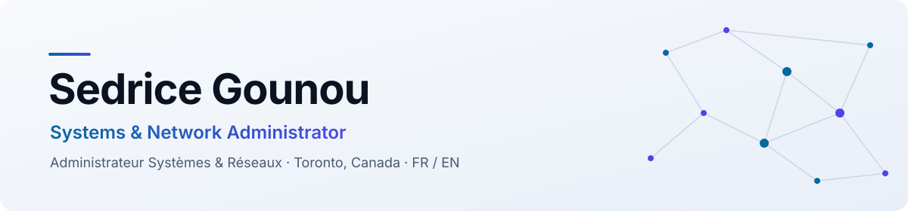

<picture>
  <source media="(prefers-color-scheme: dark)" srcset="assets/banner-dark.svg" />
  
</picture>

<p align="center">
  
</p>

<p align="center">
  <a href="https://sgbtech.ca"></a>
  <a href="https://www.linkedin.com/in/sedric-g"></a>
  
</p>

<br />

<table>
<tr>
<td width="50%" valign="top">

###  EN · About me

Bilingual IT professional with **4+ years** of experience in infrastructure, telecommunications and IoT, in Canada and abroad.

I keep systems **available, secure and well documented**: from Active Directory and identity management to enterprise networks and monitoring.

**Now learning** › Linux · Bash · Grafana
**Open to** › SysAdmin, network & monitoring roles

</td>
<td width="50%" valign="top">

###  FR · À propos de moi

Professionnel de l'informatique bilingue avec **plus de 4 ans** d'expérience en infrastructures, télécommunications et IoT, au Canada et à l'international.

Je garde les systèmes **disponibles, sécurisés et bien documentés** : de l'Active Directory et la gestion des identités jusqu'aux réseaux d'entreprise et à la supervision.

**J'apprends** › Linux · Bash · Grafana
**Ouvert à** › postes SysAdmin, réseaux et supervision

</td>
</tr>
</table>

<br />

## Certifications

<table>
<tr>
<td align="center" width="25%"><br /><sub><b>Cisco Certified<br />Network Associate</b></sub></td>
<td align="center" width="25%"><br /><sub><b>Aruba Certified<br />Network Associate</b></sub></td>
<td align="center" width="25%"><br /><sub><b>Fortinet Network<br />Security Expert</b></sub></td>
<td align="center" width="25%"><br /><sub><b>Microsoft Azure<br />Fundamentals</b></sub></td>
</tr>
</table>

<sub>🎓 Baccalauréat en technologie de l'information, Réseaux et sécurité · <i>B.IT, Networking &amp; Security</i> · Collège Boréal</sub>

<br />

## Stack

| | |
|---|---|
| **Systèmes · Systems** |     |
| **Virtualisation** |   |
| **Cloud & identité** |    |
| **Réseaux · Networking** |       |
| **Sécurité · Security** |   |
| **Supervision · Monitoring** |  -111C33?style=flat-square&logo=grafana&logoColor=818CF8) -111C33?style=flat-square&logo=linux&logoColor=818CF8) |
| **ITSM** |    |

<br />

## Parcours · Experience

```text
▸ Support technique · IoT & télématique ............ environnement 24/7, escalade structurée
▸ Consultant IT ..................................... supervision Zabbix, plan de modernisation réseau
▸ Spécialiste réseaux sans fil ...................... télécommunications
▸ Support IT & help desk ............................ transport, commerce de détail
```

<br />

## Projets · Projects

<table>
<tr>
<td width="50%" valign="top">

#### 🏢 [SGB Tech Solutions](https://sgbtech.ca)
Mon entreprise et site web.
<br /><sub><i>My company and website.</i></sub>

</td>
<td width="50%" valign="top">

#### 📱 PageFlotante
Application mobile Xamarin.Forms (C#) avec menu latéral.
<br /><sub><i>Xamarin.Forms (C#) mobile app with a flyout menu.</i></sub>

</td>
</tr>
</table>

<br />

<p align="center">
  <sub>Merci de votre visite · Thanks for stopping by</sub>
</p>
